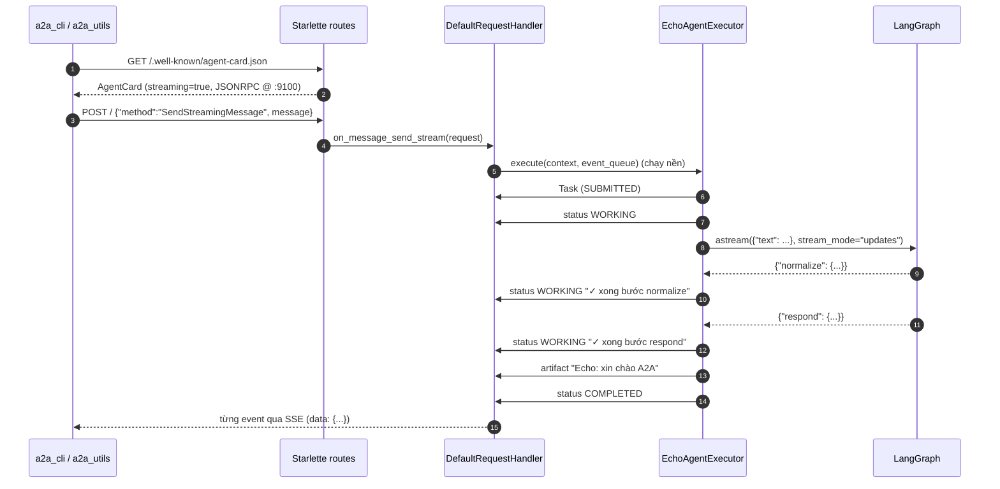

# Kiến trúc và luồng đi của source code (cập nhật: Ngày 1)

> Mục tiêu: đọc xong file này, bạn phải **vẽ lại được luồng** từ lúc gõ lệnh CLI tới lúc nhận câu trả lời, và **giải thích từng file** đang làm gì.
> Cuối file có **bài tập tự kiểm tra**.

---

## 1. Bức tranh lớn

AP Copilot là hệ **multi-agent**: mỗi agent là một **HTTP service độc lập** nói chuyện bằng **giao thức A2A**.
Ngày 1 mới có một agent mẫu (**Echo Agent**) để dựng và kiểm chứng toàn bộ "đường ống":

```
┌──────────────┐  1. GET /.well-known/agent-card.json   ┌──────────────────────────────┐
│  A2A Client   │ ─────────────────────────────────────► │  Echo Agent (A2A server)     │
│ scripts/      │  2. POST /  JSON-RPC "SendMessage"     │  agents/echo/                │
│ a2a_cli.py    │     hoặc "SendStreamingMessage" (SSE)  │   server.py   → card + routes│
│ libs/         │ ─────────────────────────────────────► │   executor.py → cầu nối A2A  │
│ a2a_utils.py  │ ◄───────────────────────────────────── │   graph.py    → LangGraph    │
└──────────────┘  3. Task / status / artifact events    └──────────────────────────────┘
```

Ba tầng bên trong một agent, **mỗi tầng một trách nhiệm**:

| Tầng | File | Trách nhiệm | Biết về A2A? |
|---|---|---|---|
| **Logic nghiệp vụ** | `graph.py` | Xử lý dữ liệu bằng LangGraph (state → node → edge) | ❌ Không |
| **Adapter giao thức** | `executor.py` | Dịch "graph chạy xong một bước" thành "sự kiện A2A" | ✅ Có |
| **Transport / hosting** | `server.py`, `__main__.py` | Agent Card, route HTTP, task store, chạy uvicorn | ✅ Có |

> 💡 **Vì sao tách vậy?** Đây là pattern **Ports & Adapters (Hexagonal)**:
> - `graph.py` test được độc lập mà không cần server (`tests/test_echo_graph.py`);
> - mai đổi sang giao thức khác (REST, gRPC, MCP) chỉ cần viết adapter mới;
> - các agent thật (Extraction, Vendor…) sẽ copy đúng khuôn 3 file này.

---

## 2. Cây thư mục và vai trò từng phần

```
ap-copilot/
├─ agents/                    # Mỗi thư mục con = 1 agent = 1 service A2A độc lập
│  ├─ __init__.py
│  └─ echo/
│     ├─ graph.py             # [LOGIC] LangGraph 2 node: normalize → respond
│     ├─ executor.py          # [ADAPTER] EchoAgentExecutor: LangGraph ⇄ sự kiện A2A
│     ├─ server.py            # [HOSTING] Agent Card + Starlette app (routes card & JSON-RPC)
│     └─ __main__.py          # Entry point: `python -m agents.echo` → uvicorn :9100
├─ libs/                      # Code dùng chung giữa các agent / orchestrator / test
│  └─ a2a_utils.py            # Client A2A: fetch_card, send_text, TaskSummary
├─ scripts/
│  └─ a2a_cli.py              # CLI gọi BẤT KỲ agent A2A nào (card / send)
├─ tests/
│  ├─ test_echo_graph.py      # Unit test: chỉ graph, không mạng
│  └─ test_echo_a2a.py        # Integration test: A2A thật, chạy in-process
├─ docs/
│  ├─ ARCHITECTURE.md         # (file này)
│  ├─ learning-log.md         # Nhật ký học mỗi ngày + câu tự hỏi
│  ├─ war-stories.md          # Sự cố thật: triệu chứng → root cause → fix → bài học
│  ├─ flashcards.md           # Thẻ ôn tập
│  └─ adr/                    # Architecture Decision Records (từ Ngày 8)
├─ .github/workflows/ci.yml   # CI: ruff + pytest trên mỗi push/PR
├─ .pre-commit-config.yaml    # Chạy ruff + kiểm tra secret/file lớn TRƯỚC mỗi commit
├─ docker-compose.yml         # Infra: Postgres + pgvector (port 5435)
├─ pyproject.toml / uv.lock   # Khai báo deps (uv), cấu hình ruff & pytest
├─ .env.example               # Mẫu biến môi trường (KHÔNG commit .env)
├─ CLAUDE.md                  # Ngữ cảnh cho AI assistant khi làm việc trong repo
├─ CONTRIBUTING.md            # Quy ước branch / commit / PR
└─ README.md
```

### 2.1 `agents/echo/graph.py`: tầng logic (LangGraph)
```python
class EchoState(TypedDict, total=False):
    text: str
    normalized: str
    reply: str
    steps: Annotated[list[str], operator.add]   # ← reducer
```
- **State** là "bảng ghi chung" chảy qua graph. `total=False` cho phép các field chưa có lúc đầu.
- **Node** là hàm thường `state → dict`. Node **chỉ trả về phần thay đổi**, ví dụ `normalize` trả `{"normalized": ..., "steps": ["normalize"]}`. LangGraph tự gộp vào state.
- **Reducer** `operator.add` trên `steps`: bình thường giá trị mới **ghi đè** giá trị cũ. Có reducer thì LangGraph **nối** `["normalize"] + ["respond"]`. Ở Ngày 5, khi nhiều agent chạy song song cùng ghi vào `checks`, chính reducer giúp kết quả không bị mất.
- **Edge**: `START → normalize → respond → END`. Ngày 3 sẽ có **conditional edge** (validate fail thì quay lại extract).
- `compile()` biến định nghĩa thành một **Runnable**: có `.invoke()`, `.ainvoke()`, `.astream()`. Sau này thêm `checkpointer=` vào đây để lưu state.

### 2.2 `agents/echo/executor.py`: tầng adapter (trái tim của Ngày 1)
`EchoAgentExecutor` kế thừa `AgentExecutor` của `a2a-sdk`. Server gọi `execute(context, event_queue)` cho mỗi request. Bên trong có 4 bước:

| Bước | Code | Ý nghĩa A2A |
|---|---|---|
| 1. Có task | `new_task_from_user_message` → `event_queue.enqueue_event(task)` | Tạo Task (trạng thái SUBMITTED). Nếu là lượt tiếp theo của task cũ (multi-turn) thì `context.current_task` đã có sẵn |
| 2. Bắt đầu | `updater.start_work()` | Chuyển sang `TASK_STATE_WORKING` |
| 3. Tiến độ | `graph.astream(..., stream_mode="updates")` → `updater.update_status(WORKING, message=...)` | Mỗi node LangGraph chạy xong thì client streaming nhận một status update |
| 4. Kết quả | `updater.add_artifact(...)` → `updater.complete()` | Artifact = sản phẩm của task; `COMPLETED` = trạng thái terminal |

- **`RequestContext`**: chứa `message` (tin nhắn user), `task_id`, `context_id`, `current_task`, `metadata`.
- **`EventQueue`**: hàng đợi sự kiện. Executor **đẩy vào**, server **đọc ra**, rồi gửi cho client (qua SSE) và lưu vào task store.
- **`TaskUpdater`**: helper tạo đúng sự kiện chuẩn (`start_work`, `update_status`, `add_artifact`, `complete`, `failed`, `requires_input`, `cancel`…). Dùng nó thay vì tự dựng protobuf.
- **`cancel()`**: được gọi khi client gửi `CancelTask`. Echo chạy tức thì nên chỉ đổi trạng thái. Agent chạy lâu (OCR) phải đặt cờ và kiểm tra cờ giữa các node.
- **Luật SDK cần nhớ** (SDK tự kiểm tra, vi phạm sẽ báo `InvalidAgentResponseError`):
  - không được đẩy event sau khi đã ở trạng thái terminal;
  - không đẩy event sau một `Message` (vì kiểu "chỉ trả message" là tương tác một phát);
  - exception không bắt được thì task chuyển sang lỗi.

### 2.3 `agents/echo/server.py`: tầng hosting
- **`build_agent_card(base_url)`**: tạo "danh thiếp". Các field quan trọng:
  - `supported_interfaces=[AgentInterface(url, protocol_binding="JSONRPC", protocol_version="1.0")]`. Đây là thay đổi của v1.0: một agent có thể khai nhiều endpoint với nhiều transport khác nhau.
  - `capabilities.streaming=True`: client biết được phép gọi `SendStreamingMessage`. Nếu để `False`, SDK từ chối request streaming.
  - `skills=[AgentSkill(id="echo", ...)]`: orchestrator sau này đọc skill để chọn agent (discovery).
- **`DefaultRequestHandler`**: "bộ não" phía server do SDK cung cấp. Nó:
  1. nhận request;
  2. dựng `RequestContext`;
  3. chạy executor;
  4. đọc `EventQueue`;
  5. lưu Task vào `task_store`;
  6. trả kết quả (gom thành Task cuối nếu non-stream, đẩy từng event nếu stream).
- **`InMemoryTaskStore`**: lưu task trong RAM, restart là mất. Ngày 12 sẽ thay bằng Postgres.
- **Routes**:
  - `create_agent_card_routes(card)` → `GET /.well-known/agent-card.json`
  - `create_jsonrpc_routes(handler, "/")` → `POST /` nhận JSON-RPC: `SendMessage`, `SendStreamingMessage`, `GetTask`, `CancelTask`…

### 2.4 `agents/echo/__main__.py`
Đọc `ECHO_HOST`, `ECHO_PORT`, `ECHO_PUBLIC_URL` rồi `uvicorn.run(...)`. **`PUBLIC_URL` khác `HOST`**: khi chạy trong Docker, server lắng nghe ở `0.0.0.0`, nhưng card phải ghi URL mà **client gọi được** (ví dụ `http://echo:9100`). Card ghi sai URL là lỗi kinh điển khi deploy.

### 2.5 `libs/a2a_utils.py`: client dùng chung
- `fetch_card(base_url, http)` dùng `A2ACardResolver` để GET card. Đây là bước **discovery**.
- `send_text(card, text, http, streaming)`:
  - `await create_client(card, ClientConfig(...))`: SDK đọc `supported_interfaces` trong card để **tự chọn transport** (JSON-RPC). Đây là coroutine nên phải `await` (war story #1).
  - `SendMessageRequest(message=new_text_message(text, role=ROLE_USER))`.
  - `client.send_message(request)` trả async iterator `StreamResponse`. Mỗi phần tử là **một trong 4 loại**: `task`, `message`, `status_update`, `artifact_update` (oneof `payload`).
- `TaskSummary` gom các event thành `task_id`, `final_state`, `progress[]`, `artifacts[]`, để CLI in ra và test assert.

### 2.6 `scripts/a2a_cli.py`
CLI tổng quát cho **mọi** agent A2A, không riêng Echo. Ngày 3 trở đi dùng để thử từng agent độc lập trước khi ghép vào orchestrator.
- `card <url>`: in Agent Card.
- `send <url> "<text>" [--no-stream]`: gửi tin, in từng event, trả exit code 0 nếu `COMPLETED`.

### 2.7 `tests/`: hai tầng test
| File | Loại | Kiểm tra | Cần mạng? |
|---|---|---|---|
| `test_echo_graph.py` | Unit | Graph chạy đúng thứ tự, reducer nối list, input rỗng | Không |
| `test_echo_a2a.py` | Integration | Card discover được; `SendMessage` và `SendStreamingMessage` đều `COMPLETED` kèm artifact; streaming có đúng 2 progress | Không: `httpx.ASGITransport` gửi request **thẳng vào app trong RAM** |

Đây là viên gạch đầu tiên của **test harness**: test được giao thức thật mà không mở cổng, chạy được trong CI, nhanh và ổn định.

### 2.8 Hạ tầng phát triển
- **uv**: quản lý Python và deps, khoá version trong `uv.lock`, CI dùng `uv sync --frozen`.
- **ruff**: lint + format (cấu hình trong `pyproject.toml`).
- **pre-commit**: chạy ruff, `detect-private-key`, `check-added-large-files` trước mỗi commit. Đây là lớp chống lộ secret đầu tiên.
- **CI** (`.github/workflows/ci.yml`): lint + test trên mỗi push và PR. Ngày 11 thêm `eval-smoke`.
- **docker-compose**: Postgres + pgvector cho checkpointer (Ngày 6), ERP giả (Ngày 2) và RAG (Ngày 8). Port chỉ bind `127.0.0.1`.

---

## 3. Luồng đi chi tiết của một request streaming

Lệnh: `uv run python -m scripts.a2a_cli send http://127.0.0.1:9100 "xin   chào   A2A"`



Diễn giải từng bước:
1. **Discovery**: client đọc card, biết agent hỗ trợ streaming qua JSON-RPC ở `:9100`.
2. **Gửi**: `create_client` chọn transport JSON-RPC và gửi `SendStreamingMessage`. Response là `text/event-stream`.
3. **Server**: `DefaultRequestHandler` dựng `RequestContext`, chạy `execute()` trong một task nền, rồi **subscribe** vào hàng đợi sự kiện.
4. **Executor**: đẩy Task, `WORKING`, mỗi bước graph thêm một status, rồi artifact, rồi `COMPLETED`.
5. **Server → client**: mỗi sự kiện thành một dòng SSE `data: {...}`. Đồng thời Task được cập nhật trong `InMemoryTaskStore`, nên `GetTask` lấy lại được.
6. **Client**: `TaskSummary.add()` phân loại theo `WhichOneof("payload")`, CLI in ra:
```
  <task>
  [TASK_STATE_WORKING]
  [TASK_STATE_WORKING] ✓ xong bước normalize
  [TASK_STATE_WORKING] ✓ xong bước respond
  <artifact_update>
  [TASK_STATE_COMPLETED]
```

**Non-streaming (`--no-stream`, method `SendMessage`) khác ở đâu?** Executor vẫn đẩy đủ sự kiện y hệt, nhưng handler **không gửi từng cái**. Nó đợi tới khi Task vào trạng thái terminal (hoặc trạng thái "dừng chờ" như `INPUT_REQUIRED`) rồi trả **một Task duy nhất** (kèm history và artifacts). Vì vậy client chỉ thấy `<task>`.

**Gọi thô không cần SDK** (để hiểu A2A chỉ là HTTP + JSON):
```bash
curl -X POST http://127.0.0.1:9100/ -H "Content-Type: application/json" -H "A2A-Version: 1.0" \
  -d '{"jsonrpc":"2.0","id":1,"method":"SendMessage","params":{"message":{"messageId":"m1","role":"ROLE_USER","parts":[{"text":"hi"}]}}}'
```

---

## 4. Ngày 1 nằm ở đâu trong kiến trúc cuối cùng

```
Ngày 1 (đã có)                    Sẽ thành (Ngày 2 → 14)
─────────────────                 ───────────────────────────────────────────────
agents/echo/graph.py        →     agents/extraction/graph.py (ocr→extract→validate→repair)
agents/echo/executor.py     →     executor cho mọi agent, có INPUT_REQUIRED, cancel thật
agents/echo/server.py       →     card có securitySchemes (JWT), TaskStore Postgres
libs/a2a_utils.py           →     orchestrator/a2a_client.py (timeout, retry, idempotency, trace)
scripts/a2a_cli.py          →     công cụ debug từng agent
tests/test_echo_a2a.py      →     tests/mock_agents + contract + chaos (test harness)
(chưa có)                   →     mcp_servers/ (Ngày 2), orchestrator/ (Ngày 5), libs/harness (Ngày 9), evals/ (Ngày 10)
```

---

## 5. Bài tập tự kiểm tra (làm trước khi sang Ngày 2)

1. **Dự đoán rồi chạy**: thêm node thứ ba `shout` (viết hoa reply) vào giữa `respond` và `END`. CLI streaming sẽ in thêm dòng nào? Test nào sẽ fail và vì sao?
2. Bỏ `operator.add` khỏi `steps`. Test `test_graph_runs_both_nodes_in_order` sẽ báo gì? Giải thích bằng khái niệm reducer.
3. Đổi `AgentCapabilities(streaming=False)`. Lệnh `send` (streaming) và `--no-stream` lần lượt ra sao?
4. Trong `execute()`, nếu gọi `updater.complete()` **trước** `add_artifact()` thì chuyện gì xảy ra? (Gợi ý: luật "không có event sau terminal state".)
5. Vì sao test không cần mở cổng mà vẫn kiểm tra được giao thức thật?
6. Giải thích trong 2 phút, không nhìn: Agent Card, Task, Message, Artifact, `AgentExecutor`, `EventQueue`, `DefaultRequestHandler`.

> Ghi câu trả lời vào `docs/learning-log.md`. Chỗ nào ấp úng thì đọc lại mục tương ứng ở trên.
